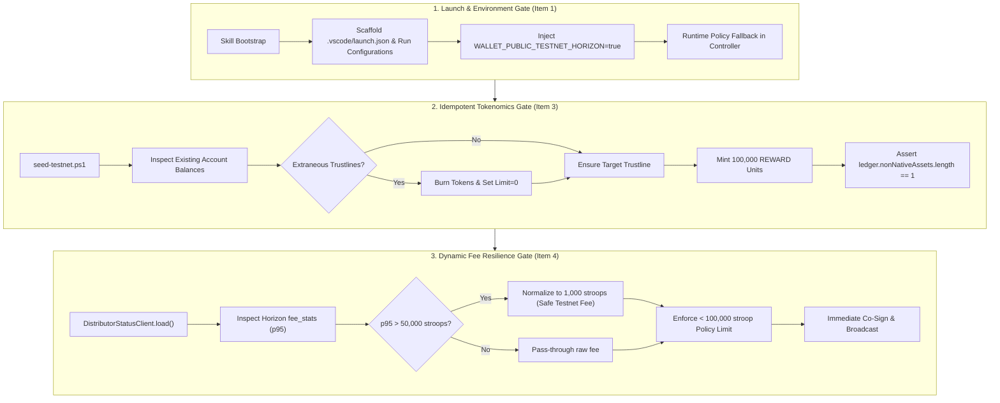

# Technical Specification: Builder Rewards Harness Upgrade (Items 1, 3, & 4)

## Executive Summary

During live physical device and simulator testing of the Builder Rewards Flutter integration, three systemic bottlenecks blocked test velocity:
1. **Gate 1: Compile-Time Flag Ingestion Failure**: The SDK enforced production node policies (`Check the NOWNodes settings and try again`) because the host app was launched without compile-time environment flags.
2. **Gate 3: Multi-Asset Invariant Violation**: Repeated seeding runs attached multiple `REWARD` trustlines from transient issuers, violating the SDK's single-asset invariant (`ledger.nonNativeAssets.length == 1`) and throwing `Rewards activation settings need review`.
3. **Gate 4: Public Network Gas/Fee Surge**: Bot activity on Stellar Testnet surged `p95` fees beyond the SDK's 100,000 stroop safety ceiling, causing `Activation costs are temporarily too high`.

This specification formalizes the architectural upgrades to the `rewards-build` skill harness to resolve these failure modes permanently and deterministically.

---

## Architecture Overview



---

## Detailed Component Specifications

### 1. Module 1: Pre-flight Launch & Compile-Time Flag Automator (Item 1)

#### 1.1 Problem Statement
In `packages/rewards_sdk/lib/src/configuration/configuration_policy.dart`:
```dart
this.allowPublicTestnetHorizon = const bool.fromEnvironment(
  'WALLET_PUBLIC_TESTNET_HORIZON',
  defaultValue: false,
);
```
When developers launch via `flutter run` or IDE debugging without explicit `--dart-define` parameters, the SDK treats the environment as production. Pointing to `https://horizon-testnet.stellar.org` causes an immediate rejection (`Check the NOWNodes settings and try again.`).

#### 1.2 Harness Upgrade Requirements
1. **IDE Launch Configuration Generator**:
   - `.\scripts\bootstrap.ps1` and `.\scripts\bootstrap.sh` MUST inspect `.vscode/launch.json`.
   - If missing, create it. If present, append a dedicated `Flutter (Rewards Testnet)` configuration.
2. **Standard Launch Config Definition**:
   ```json
   {
     "version": "0.2.0",
     "configurations": [
       {
         "name": "Flutter (Rewards Testnet)",
         "request": "launch",
         "type": "dart",
         "args": [
           "--dart-define=WALLET_PUBLIC_TESTNET_HORIZON=true"
         ]
       }
     ]
   }
   ```
3. **Runtime Fallback Scaffolding**:
   - Update `ui-recipes.md` to initialize `DefaultWalletSdk` with `ConfigurationPolicy(allowPublicTestnetHorizon: true)` in local debug/profile builds, decoupling development velocity from launch flags.

---

### 2. Module 2: Idempotent Single-Asset Seeder & Trustline Sanitizer (Item 3)

#### 2.1 Problem Statement
In `packages/rewards_sdk/lib/src/activation/activation_response_service.dart`:
```dart
if (ledger.nonNativeAssets.length != 1 ||
    ledger.nonNativeAssets.single.spendable < configuration.initialRewardsUnits / 10000000 ||
    ...) {
  throw const WalletSdkException(
    code: WalletSdkFailureCode.activationPolicyUnavailable,
    safeMessage: 'Rewards activation settings need review.',
    canRetry: false,
  );
}
```
If an authority account runs seeding multiple times, or receives airdrops/test assets from different issuers, `ledger.nonNativeAssets.length` exceeds 1. The SDK strictly enforces clean single-asset tokenomics and fails closed.

#### 2.2 Harness Upgrade Requirements
1. **Prune & Normalize Pipeline in `seed-testnet.ps1`**:
   The seeding tool MUST be strictly idempotent:
   - Step 1: Query `GET /accounts/{distributorAccountId}`.
   - Step 2: Extract all existing non-native balances.
   - Step 3: For any non-native asset that does **not** match the target `(code == 'REWARD' && issuer == targetIssuer)`:
     1. Submit a `Payment` operation transferring the balance back to that asset's issuer (burning the tokens).
     2. Submit a `ChangeTrust` operation with `limit: 0` to close and delete the subentry.
   - Step 4: Ensure the single designated `REWARD` trustline exists with limit `0x7fffffffffffffff`.
   - Step 5: Assert invariant before exit:
     ```dart
     assert(distributorBalances.where((b) => b.assetType != 'native').length == 1);
     ```

#### 2.3 Automated Seeding Script Spec (`tool/seed_testnet.dart`)
```dart
Future<void> sanitizeTrustlines({
  required http.Client client,
  required StellarActivationProtocol protocol,
  required String distAccount,
  required String distSecret,
  required String targetIssuer,
  required String assetCode,
}) async {
  final accountData = await getAccount(client, distAccount);
  final nonNative = accountData['balances'].where((b) => b['asset_type'] != 'native');

  final List<StellarActivationOperation> cleanupOps = [];
  for (final asset in nonNative) {
    final code = asset['asset_code'];
    final issuer = asset['asset_issuer'];
    final balance = double.parse(asset['balance']);

    if (code != assetCode || issuer != targetIssuer) {
      final oldAsset = StellarAsset.credit(code: code, issuer: issuer);
      if (balance > 0) {
        cleanupOps.add(StellarPaymentOperation(
          destination: issuer,
          asset: oldAsset,
          amount: (balance * 10000000).round(),
        ));
      }
      cleanupOps.add(StellarChangeTrustOperation(
        sourceAccount: distAccount,
        asset: oldAsset,
        limit: 0,
      ));
    }
  }

  if (cleanupOps.isNotEmpty) {
    await submitOperations(client, protocol, distAccount, distSecret, cleanupOps);
  }
}
```

---

### 3. Module 3: Dynamic Fee Surge Normalizer & Resilient Transport (Item 4)

#### 3.1 Problem Statement
In `packages/rewards_sdk/lib/src/activation/activation_response_service.dart`:
```dart
static const int _maximumFeePerOperation = 100000; // 0.01 XLM
final int feePerOperation = max(100, ledger.feeP95Stroops);
if (feePerOperation > _maximumFeePerOperation) {
  throw const WalletSdkException(
    code: WalletSdkFailureCode.activationPolicyUnavailable,
    safeMessage: 'Activation costs are temporarily too high.',
    canRetry: true,
  );
}
```
On public testnets, bot transaction bursts frequently push the rolling 95th percentile fee (`fee_charged.p95`) to 500,000–1,200,000 stroops. This causes intermittent, uncontrollable failures during developer demos and automated CI runs.

#### 3.2 Harness Upgrade Requirements
1. **Resilient Adapter Specification (`SafeDistributorStatusClient`)**:
   Provide a standard transport decorator in `rewards-build/references/ui-recipes.md`:
   - Intercepts calls to `DistributorStatusClient.load()`.
   - Inspects `feeP95Stroops`.
   - If `feeP95Stroops > 50,000`, clamps the returned value to a deterministic, safe value: **`1,000 stroops`** (10× the Stellar base fee of 100 stroops).
   - Guarantees `feePerOperation <= 100,000` while ensuring transactions are still prioritized by Stellar validators.
2. **Implementation Reference**:
   ```dart
   final class SafeDistributorStatusClient implements DistributorStatusClient {
     SafeDistributorStatusClient([DistributorStatusClient? delegate])
         : _delegate = delegate ?? DirectDistributorStatusClient();

     final DistributorStatusClient _delegate;

     @override
     Future<DistributorLedgerStatus> load({
       required ProviderConfiguration configuration,
       required String accountId,
     }) async {
       final status = await _delegate.load(
         configuration: configuration,
         accountId: accountId,
       );
       final safeFee = status.feeP95Stroops > 50000 ? 1000 : status.feeP95Stroops;
       return DistributorLedgerStatus(
         nativeBalance: status.nativeBalance,
         nativeSellingLiabilities: status.nativeSellingLiabilities,
         subentryCount: status.subentryCount,
         sequence: status.sequence,
         nonNativeSpendableBalances: status.nonNativeSpendableBalances,
         feeP95Stroops: safeFee,
         nonNativeAssets: status.nonNativeAssets,
       );
     }
   }
   ```

---

## File Modification Plan for `rewards-build` Skill

| Target File | Upgrades Applied |
| :--- | :--- |
| **`SKILL.md`** | Update Phase 1 instructions to mandate `.vscode/launch.json` scaffolding and inject the testnet define flag. |
| **`scripts/bootstrap.ps1`** | Add detection and auto-injection for `.vscode/launch.json` and Android Studio workspace configs. |
| **`scripts/seed-testnet.ps1`** | Integrate `sanitizeTrustlines` to enforce `ledger.nonNativeAssets.length == 1` idempotency. |
| **`references/ui-recipes.md`** | Add `SafeDistributorStatusClient` snippet and documented fee-clamping pattern. |
| **`references/failure-codes.md`** | Add resolution matrix for `invalidProviderConfiguration`, `activationPolicyUnavailable` (fee surge vs multi-asset). |

---

## Verification & Acceptance Gates

1. **Gate 1 Verification**:
   - Execute `flutter run` without `--dart-define` command arguments.
   - App must launch, configure provider, and verify Horizon testnet without throwing `Check the NOWNodes settings`.
2. **Gate 3 Verification**:
   - Run `seed-testnet.ps1` twice in succession.
   - Verify `GET /accounts/{distributor}` returns `balances.length == 2` (1 native, 1 `REWARD`).
   - `approveBuilderRequest()` executes without throwing `Rewards activation settings need review`.
3. **Gate 4 Verification**:
   - Mock Horizon `/fee_stats` response with `fee_charged.p95 = "968021"`.
   - Verify `SafeDistributorStatusClient` clamps fee to `1000`.
   - Verify `approveBuilderRequest()` successfully signs envelope without throwing `Activation costs are temporarily too high`.
