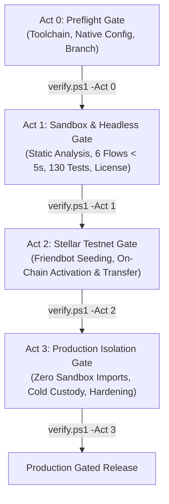

# Rewards Build Skill — Comprehensive Step-by-Step Test Plan

This test plan defines the end-to-end verification strategy for the **BuilderPros Rewards SDK (Headless Capability)** and its accompanying **Rewards Build Skill Suite**, mapped directly against the specifications in [build-plan.docx](file:///D:/TheFlutterBuilderProsApp/rewards-build-skill/build-plan.docx).

---

## 1. Test Objectives & Architectural Invariants

The test plan validates the following non-negotiable principles:
1. **Headless Capability**: `packages/rewards_sdk` must contain zero UI widgets, presentation libraries, or state management frameworks (Bloc, Riverpod, GetX). All APIs are pure Dart async methods (`WalletSdk`).
2. **Deterministic Sandbox**: `createSandboxWalletSdk()` operates 100% in-memory with zero physical network calls, executing all 6 flows in under 5 seconds.
3. **Strict Boundary Isolation**: `package:rewards_sdk/rewards_sdk.dart` must never export `sandbox.dart`. Host production code must have zero references to `sandbox.dart`.
4. **Gate-Driven Enforcement**: Progression across the 4-act lifecycle is strictly gated by verification scripts (`verify.ps1`) that exit non-zero on failure.
5. **Cross-Platform Licensing**: Package file checksums must be normalized (CRLF converted to LF) before SHA-256 computation to ensure consistency between Windows and POSIX environments.
6. **Live Testnet Ledger**: Automated seeding scripts must fund accounts via Friendbot (handling rate limits) and successfully create the `REWARD` asset trustline and distributor balances.



---

## 2. Step-by-Step Test Execution Plan

### Step 1: Preflight Toolchain & Branch Hygiene Verification (Act 0)
**Goal**: Ensure the execution environment satisfies all SDK toolchain and native capability prerequisites before running builds or migrations.

| # | Action | Command | Expected Output / Invariant |
|:---|:---|:---|:---|
| 1.1 | Verify Flutter SDK version | `flutter --version` | Flutter `>=3.24.0`, Dart `>=3.5.0` (target `^3.9.2`). |
| 1.2 | Verify Git branch isolation | `git rev-parse --abbrev-ref HEAD` | Must be `feature/rewards-build` (or isolated feature branch). |
| 1.3 | Run automated Act 0 verification gate | `powershell -File .\skills\rewards-build\scripts\verify.ps1 -Act 0` | Exit code `0`. Prints `[PASS]` for toolchains and branch. Creates/updates `.rewards/state.json` with `{ "act": 0, ... }`. |
| 1.4 | Inspect Android native prerequisites | Inspect `android/app/build.gradle` and `AndroidManifest.xml` | `minSdkVersion >= 23`, `USE_BIOMETRIC` permission declared, `MainActivity` extends `FlutterFragmentActivity`. |
| 1.5 | Inspect iOS native prerequisites | Inspect `ios/Runner/Info.plist` | `NSFaceIDUsageDescription` entry present. |

---

### Step 2: Automated Bootstrap & Dependency Verification
**Goal**: Verify automated package unpacking, dependency graph resolution, and installation record generation.

| # | Action | Command | Expected Output / Invariant |
|:---|:---|:---|:---|
| 2.1 | Run bootstrap script | `powershell -File .\skills\rewards-build\scripts\bootstrap.ps1` | Resolves dependencies in `packages/rewards_sdk`, `templates/rewards_harness`, and root app. Writes `.rewards/installed.json` with version `0.1.0`. |
| 2.2 | Verify `pubspec.yaml` in SDK package | Inspect [pubspec.yaml](file:///D:/TheFlutterBuilderProsApp/packages/rewards_sdk/pubspec.yaml) | Zero UI dependencies. Only: `flutter`, `cryptography`, `flutter_secure_storage`, `http`, `local_auth`, `shared_preferences`. |

---

### Step 3: Static Analysis, Formatting & Architectural Boundary Tests
**Goal**: Ensure warning-free Dart code, strict adherence to lint rules, and no leaky abstractions.

| # | Action | Command | Expected Output / Invariant |
|:---|:---|:---|:---|
| 3.1 | Check SDK formatting | `dart format --output=none --set-exit-if-changed packages/rewards_sdk` | 0 changed files, exit code `0`. |
| 3.2 | Check harness formatting | `dart format --output=none --set-exit-if-changed templates/rewards_harness` | 0 changed files, exit code `0`. |
| 3.3 | Static analysis of `rewards_sdk` | `cd packages/rewards_sdk; flutter analyze` | `No issues found!`, exit code `0`. |
| 3.4 | Static analysis of `rewards_harness` | `cd templates/rewards_harness; flutter analyze` | `No issues found!`, exit code `0`. |
| 3.5 | Validate export boundary | Inspect [rewards_sdk.dart](file:///D:/TheFlutterBuilderProsApp/packages/rewards_sdk/lib/rewards_sdk.dart) | Does **NOT** export `sandbox.dart`. |
| 3.6 | Host app regression & import boundary | `flutter test test/wallet_sdk_import_boundary_test.dart test/qr_input_adapter_test.dart` | All tests pass, proving backward-compatible re-exports and boundary compliance. |

---

### Step 4: Deterministic In-Memory Sandbox & 6-Flow Headless Verification
**Goal**: Confirm that all 6 core business flows execute headlessly in an in-memory sandbox with zero physical HTTP calls and under 5 seconds.

| # | Flow | Executed SDK Calls | Assertion & Invariants |
|:---|:---|:---|:---|
| 4.1 | **Flow 1: Activation Request** | `getActivationStatus()`<br>`startActivation(BuilderIdentity)`<br>`restoreActivationRequest()` | Initial status is `notActivated`. Request yields valid `ACT-...` QR payload and valid expiration timestamp. |
| 4.2 | **Flow 2: App Master Approval** | `importDistributorSecret(secret)`<br>`inspectBuilderRequest(qrValue)`<br>`approveBuilderRequest(requestId)` | App Master parses payload, builds and signs envelope, returning `RES-...` package without touching a network node. |
| 4.3 | **Flow 3: Activation Completion** | `inspectActivationResponse(qrValue)`<br>`approveActivation(responseId)`<br>`reconcileActivation()` | Builder cosigns envelope, submits to `SandboxTransport`, reaches `WalletActivationState.active`. |
| 4.4 | **Flow 4: Read Surfaces** | `getRewardsReceiveIdentity()`<br>`getRewardsBalance()`<br>`getRewardsHistory()` | Returns valid public address, available balance `>= 1.0`, and non-empty history log. |
| 4.5 | **Flow 5: Transfer & Send** | `inspectRewardsRecipient(address)`<br>`prepareRewardsTransfer(...)`<br>`authorizeRewardsTransfer(...)`<br>`approveRewardsTransfer(...)` | Transfer settles to `RewardsTransferState.confirmed`. Fee and balance deductions correctly updated. |
| 4.6 | **Flow 6: Access & Recovery** | `getRewardsAccessState()`<br>`lockRewards()` / `unlockRewards()`<br>`createRewardsBackup(passphrase)`<br>`removeRewardsAccess()`<br>`restoreRewardsBackup(...)` | Generates AES-256-GCM `BRB1....` backup string. Secure wipe purges credentials. Restore recovers balance and keypair. |
| 4.7 | **Sandbox Failure Simulation** | `SeedableSandbox.failNext(code)` | Simulates failures (e.g. `insufficientRewardsFunds`, `activationRequestExpired`) without ledger dependency. |

> [!TIP]
> Execute the complete sandbox suite directly:
> ```powershell
> cd D:\TheFlutterBuilderProsApp\packages\rewards_sdk
> flutter test test/sandbox_test.dart
> ```
> Expected output: All 6 flows pass in `< 5.0 seconds`.

---

### Step 5: Exhaustive Unit Test Suite (130 Tests)
**Goal**: Validate full cryptographic correctness, error cataloging, state machines, and edge case resilience.

| # | Test Suite | File Link | Coverage Focus |
|:---|:---|:---|:---|
| 5.1 | Key Generation & StrKey | [wallet_sdk_strkey_test.dart](file:///D:/TheFlutterBuilderProsApp/packages/rewards_sdk/test/wallet_sdk_strkey_test.dart) | Ed25519 seed encoding, checksums, public account validation. |
| 5.2 | Protocol Serialization | [wallet_sdk_protocol_test.dart](file:///D:/TheFlutterBuilderProsApp/packages/rewards_sdk/test/wallet_sdk_protocol_test.dart) | XDR envelope packing, change trust operations, payment operations. |
| 5.3 | Transfer Authentication | [wallet_sdk_authorization_test.dart](file:///D:/TheFlutterBuilderProsApp/packages/rewards_sdk/test/wallet_sdk_authorization_test.dart) | Biometric gates, prompt timeouts, cancellation handling. |
| 5.4 | Active Rewards & Balances | [wallet_sdk_active_rewards_test.dart](file:///D:/TheFlutterBuilderProsApp/packages/rewards_sdk/test/wallet_sdk_active_rewards_test.dart) | Balance parsing, reserve locks, non-native asset isolation. |
| 5.5 | Transfer Submission & Send | [wallet_sdk_send_test.dart](file:///D:/TheFlutterBuilderProsApp/packages/rewards_sdk/test/wallet_sdk_send_test.dart) | Multi-operation atomic transactions, nonce increments, sequence tracking. |
| 5.6 | Backup & Disaster Recovery | [wallet_sdk_recovery_test.dart](file:///D:/TheFlutterBuilderProsApp/packages/rewards_sdk/test/wallet_sdk_recovery_test.dart) | PBKDF2 (210,000 rounds HMAC-SHA256) + AES-GCM encryption/decryption. |
| 5.7 | Transport & Horizon Errors | [wallet_sdk_transport_test.dart](file:///D:/TheFlutterBuilderProsApp/packages/rewards_sdk/test/wallet_sdk_transport_test.dart) | HTTP 429 backoff, 502 gateway fallback, malformed JSON handling. |

> [!NOTE]
> Run all unit tests:
> ```powershell
> cd D:\TheFlutterBuilderProsApp\packages\rewards_sdk
> flutter test
> ```
> All 24 test files (130 total tests) must pass.

---

### Step 6: Reference Harness Smoke Testing (`templates/rewards_harness`)
**Goal**: Verify that an external consumer can integrate and run `rewards_sdk` as a standalone path dependency.

| # | Action | Command | Expected Output / Invariant |
|:---|:---|:---|:---|
| 6.1 | Run harness smoke test | `cd templates/rewards_harness; flutter test test/smoke_test.dart` | Runs all 6 headless flows via consumer dependency wiring. Must pass. |
| 6.2 | Run harness CLI demo | `cd templates/rewards_harness; dart run bin/main.dart` | Prints execution steps for Flows 1–6 to standard output with zero exceptions. |

---

### Step 7: Packaging, Licensing & Cross-Platform Checksum Verification (Act 1 Gate)
**Goal**: Verify license generation, distribution archive creation, and cross-platform line ending normalization.

| # | Action | Command | Expected Output / Invariant |
|:---|:---|:---|:---|
| 7.1 | Run packager script | `powershell -File .\skills\rewards-build\scripts\package-sdk.ps1` | Generates `license.json` with SHA-256 hashes of all `.dart` files; creates `build/dist/rewards_sdk-0.1.0.zip`. |
| 7.2 | Run complete Act 1 Gate | `powershell -File .\skills\rewards-build\scripts\verify.ps1 -Act 1` | Validates format, static analysis, sandbox speed, 130 unit tests, harness smoke test, host regression, and `license.json` integrity. Updates `.rewards/state.json` to `{ "act": 1, ... }`. |
| 7.3 | **Tamper Test (Negative)** | Edit a character in `packages/rewards_sdk/lib/rewards_sdk.dart`, run `verify.ps1 -Act 1` | Must **FAIL** immediately with `Hash mismatch for lib/rewards_sdk.dart (tampering detected)`. Revert after testing. |

---

### Step 8: Stellar Testnet Automation & On-Chain Ledger Verification (Act 2 Gate)
**Goal**: Verify live Stellar Testnet account provisioning, Friendbot rate-limit handling, token issuance, and on-chain payments.

| # | Action | Command | Expected Output / Invariant |
|:---|:---|:---|:---|
| 8.1 | Run testnet seeding | `powershell -File .\skills\rewards-build\scripts\seed-testnet.ps1` | 1. Generates Issuer & Distributor keypairs.<br>2. Funds both via Friendbot with exponential retry on HTTP 429.<br>3. Submits `change_trust` operation for `REWARD`.<br>4. Mints 100,000 `REWARD` tokens to Distributor.<br>5. Saves secrets to `.secrets/testnet-authority.json`. |
| 8.2 | Verify Distributor Balances | Query Horizon API for Distributor account | Exactly two balances: native XLM (`~9,997.9 XLM`) and credit `REWARD` (`100000.0000000`). |
| 8.3 | Run Act 2 Verification Gate | `powershell -File .\skills\rewards-build\scripts\verify.ps1 -Act 2` | Verifies presence of `.secrets/testnet-authority.json` and active Horizon connectivity. Updates `.rewards/state.json` to `{ "act": 2, ... }`. |
| 8.4 | Live App Master Activation (Dual Role / Emulator) | Run host app with `--dart-define=WALLET_PUBLIC_TESTNET_HORIZON=true` | Import Distributor secret from `.secrets/testnet-authority.json`. Complete Builder activation live on Testnet ledger. Status becomes `active`. |
| 8.5 | Live Testnet Transfer | Initiate transfer from Builder to Distributor | Transfer confirms on-chain (`confirmed`). `getRewardsHistory()` returns payment transaction hash matching Stellar Expert Testnet explorer. |

---

### Step 9: Production Isolation & Security Hardening Verification (Act 3 Gate)
**Goal**: Verify that production builds strictly isolate testing fakes and meet enterprise custody standards.

| # | Action | Command | Expected Output / Invariant |
|:---|:---|:---|:---|
| 9.1 | Verify sandbox import isolation | `powershell -File .\skills\rewards-build\scripts\verify.ps1 -Act 3` | Scans `lib/` recursively. Asserts **zero** imports of `rewards_sdk/sandbox.dart`. |
| 9.2 | Verify Issuer key cold-custody | Inspect project codebase and repository | Issuer secret is nowhere in version control, mobile storage, or client configuration. |
| 9.3 | Verify Horizon endpoint policy | Inspect `packages/rewards_sdk/lib/src/configuration/configuration_policy.dart` | Production builds enforce secure NOWNodes endpoints; public horizon testnet endpoint rejected unless `WALLET_PUBLIC_TESTNET_HORIZON=true` flag is explicitly provided. |

---

## 3. Verification Commands Summary Matrix

| Scope | Automated Execution Command | Target SLA | Gate Controlled |
|:---|:---|:---|:---|
| **Act 0 Preflight** | `powershell -File .\skills\rewards-build\scripts\verify.ps1 -Act 0` | `< 3 sec` | Preflight check |
| **Act 1 Sandbox & Integrity** | `powershell -File .\skills\rewards-build\scripts\verify.ps1 -Act 1` | `< 60 sec` | Free tier gate |
| **Act 2 Testnet Seeding** | `powershell -File .\skills\rewards-build\scripts\seed-testnet.ps1` | `10 - 30 sec` | Authority provisioning |
| **Act 2 Connectivity Gate** | `powershell -File .\skills\rewards-build\scripts\verify.ps1 -Act 2` | `< 5 sec` | Testnet verification |
| **Act 3 Production Hardening** | `powershell -File .\skills\rewards-build\scripts\verify.ps1 -Act 3` | `< 3 sec` | Production deployment |
| **Harness Smoke Test** | `cd templates/rewards_harness; flutter test test/smoke_test.dart` | `< 5 sec` | Integration smoke |
| **SDK Unit Test Suite** | `cd packages/rewards_sdk; flutter test` | `< 25 sec` | Cryptographic correctness |

---

## 4. Defect Classification & Remediation Guide

| Failure Mode | Root Cause Detection | Recommended Fix |
|:---|:---|:---|
| `Hash mismatch for ... (tampering detected)` | A file in `packages/rewards_sdk/lib/` was modified without updating `license.json` or CRLF line endings were changed. | Run `dart run packages/rewards_sdk/tool/package_release.dart` to recalculate normalized LF hashes. |
| `Forbidden: sandbox.dart referenced in production app code` | Host app imported `package:rewards_sdk/sandbox.dart` in production `lib/`. | Replace with `package:rewards_sdk/rewards_sdk.dart` and use real `createWalletSdk()`. |
| `Friendbot rate limit (HTTP 429)` | Horizon testnet faucet flooded. | Seeding script includes automatic exponential backoff. Allow script to retry or switch network. |
| `Sandbox test exceeding 5.0 seconds` | Accidental physical HTTP call or unmocked secure storage wait introduced. | Verify `MockClient` or `SandboxTransport` intercept is registered. |
